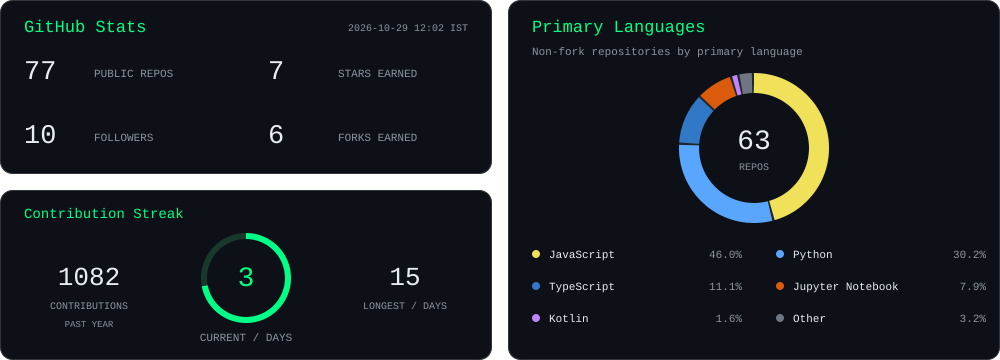
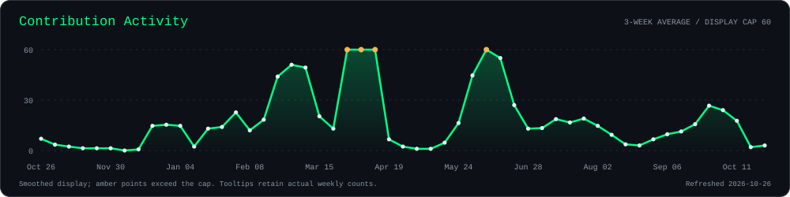
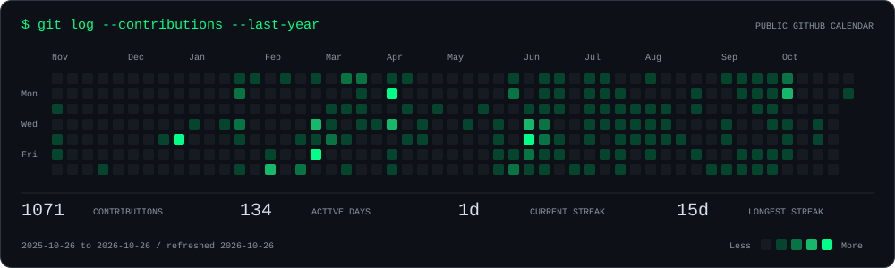

<picture>
  <source media="(max-width: 600px)" srcset="public/profile/header-mobile.svg?v=20261026-r22" />
  
</picture>

<picture>
  <source media="(max-width: 600px)" srcset="public/profile/terminal-profile-mobile.svg?v=20261026-r22" />
  
</picture>

##  About Me

I'm **Navneet Tripathi**, an Information Technology undergraduate at **SGSITS, Indore**, focused on AI engineering, backend systems, and full-stack development. I build applications that connect secure APIs, reliable data systems, and intelligent workflows, taking ideas from an initial prototype to deployed software.

My backend work includes **FastAPI, Node.js, Express, PostgreSQL, MySQL, and Redis**, with experience in authentication, role-based access, caching, payments, and real-time communication. On the AI side, I develop agent workflows with **LangGraph and LangChain**, retrieval-augmented generation, MCP integrations, and tool calling. I also explore **LLM evaluations and AI security**, including guardrails, model reliability, observability, and the practical trade-offs between quality, latency, and cost.

My experience includes a software engineering internship focused on backend services and computer-vision research through an **MPCST-funded project at SGSITS**, using OpenCV and MediaPipe for real-time feedback. My projects include **AutoBot, the SGSITS college platform, and EDU-AI**. Alongside building, I continue strengthening my foundations in data structures, system design, and machine learning.

##  Tech Stack

### Software & Backend

<picture>
  <source media="(max-width: 600px)" srcset="public/profile/tech-stack-mobile.svg?v=20261026-r22" />
  
</picture>

### AI, Agents & Machine Learning

<picture>
  <source media="(max-width: 600px)" srcset="public/profile/ai-stack-mobile.svg?v=20261026-r22" />
  
</picture>

**Building with:** RAG · tool calling · MCP · vector search · **LLM evaluations** · DeepEval · **AI security** · guardrails · OpenCV & MediaPipe.

##  GitHub Insights

<picture>
  <source media="(max-width: 600px)" srcset="public/profile/insights-mobile.svg" />
  
</picture>

**Learn deeply. Build relentlessly.**

