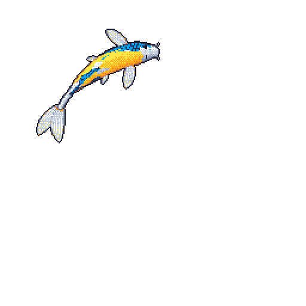

<picture>
  <source media="(max-width: 600px)" srcset="public/profile/header-mobile.svg?v=20261026-r22" />
  
</picture>

<picture>
  <source media="(max-width: 600px)" srcset="public/profile/terminal-profile-mobile.svg?v=20261026-r22" />
  
</picture>

##  About Me

I'm **Navneet Tripathi**, an Information Technology undergraduate at **SGSITS, Indore**, building AI applications, backend systems, and full-stack products. I work with **FastAPI, Node.js, and SQL databases**, and build agent workflows using **LangGraph, LangChain, RAG, and MCP**.

My experience spans a backend engineering internship and **MPCST-funded computer-vision research**. My projects include **AutoBot, the SGSITS college platform, and EDU-AI**, with a growing focus on **LLM evaluations and AI security**.

##  Tech Stack

### Software & Backend

<picture>
  <source media="(max-width: 600px)" srcset="public/profile/tech-stack-mobile.svg?v=20261026-r22" />
  
</picture>

### AI, Agents & Machine Learning

<picture>
  <source media="(max-width: 600px)" srcset="public/profile/ai-stack-mobile.svg?v=20261026-r22" />
  
</picture>

**Building with:** RAG · tool calling · MCP · vector search · **LLM evaluations** · DeepEval · **AI security** · guardrails · OpenCV & MediaPipe.

##  GitHub Insights

<picture>
  <source media="(max-width: 600px)" srcset="public/profile/insights-mobile.svg?v=20261112T074647Z" />
  
</picture>

**Learn deeply. Build relentlessly.**

